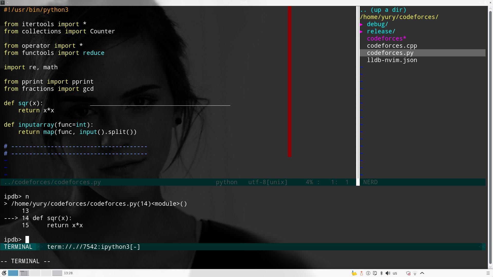
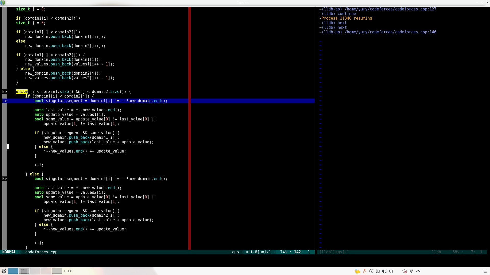

# vim

A Neovim-first configuration that still runs in Vim 8+. It is tuned for
Python and C/C++, with LaTeX, Rust, Hack/PHP and JavaScript support on top.
Completion and LSP go through YouCompleteMe by default; static linters run
through neomake.

## Table of contents

  * [Requirements](#requirements)
  * [Install](#install)
  * [Layout](#layout)
  * [Configuration](#configuration)
  * [Mappings and commands](#mappings-and-commands)
  * [Plugins](#plugins)

## Requirements

Required:

  * `nvim` (Vim 8+ also works, with fewer features)
  * `python3`, plus the `pynvim` module so Neovim has a python3 provider
    (YouCompleteMe, UltiSnips and the jedi call-signature popup need it)
  * `cmake` and a C/C++ toolchain with python3 headers, to build
    YouCompleteMe (`install.py --clangd-completer`)
  * `curl`, used to fetch vim-plug on first start
  * `git`
  * `rg` (ripgrep), used by `:Rg`, vim-grepper and Telescope
  * `universal-ctags`, used by Tagbar and the ctags fallback for go-to

Optional:

  * `node`, `go`, `rustc`: when found on PATH at install time, YouCompleteMe
    is built with `--ts-completer`, `--go-completer` and `--rust-completer`
  * `ag`: second choice for vim-grepper after `rg`
  * `tree-sitter` CLI (0.26+, not from npm): lets nvim-treesitter install
    parsers on demand
  * `pyright-langserver`: added to `g:lsp_servers` when found (see below)
  * `flake8`, `pylint`, `cpplint`: linters run by neomake
  * `clang-format`, `autopep8`: formatters for `:Autoformat`
  * `clang++`: compiles single C++ files for `<leader>xx`
  * `ptipython3`: the Python REPL opened by `<leader>ip`
  * `latexmk` and a PDF viewer for vimtex (Okular is configured if present)

macOS:

    brew install neovim python cmake curl git ripgrep universal-ctags
    brew install node go rust the_silver_searcher pyright tree-sitter-cli \
                 flake8 pylint cpplint clang-format autopep8
    python3 -m pip install --user pynvim

Debian/Ubuntu:

    sudo apt install neovim python3 python3-dev python3-pynvim cmake \
                     build-essential curl git ripgrep universal-ctags
    sudo apt install nodejs npm golang rustc silversearcher-ag \
                     flake8 pylint clang-format python3-autopep8
    pipx install cpplint
    npm install -g pyright

## Install

Standalone:

    git clone https://github.com/Bellaktris/vim ~/.files/vim
    python3 ~/.files/vim/configs.py

As part of the dotfiles (`Bellaktris/.files`), the top-level installer
fetches this repo as a submodule and runs `configs.py` for you:

    ~/.files/install

`configs.py` does the following:

  * writes `~/.vimrc`, a small bootstrap with the absolute paths of this
    checkout baked in, and `~/.config/nvim/init.vim`, which just sources
    `~/.vimrc`. Either file is left alone when it is a symlink, so the
    dotfiles installer can stow its own copies (`main/.vimrc` there is an
    equivalent bootstrap hard-coded to `~/.files/vim`).
  * creates `~/.tempd/undodir` (undo history, viminfo, scratch files and
    the run/build helper files all live in `~/.tempd`)
  * creates an empty `vimrc/secret.vim` if there is none
  * runs `:PlugInstall | UpdateRemotePlugins` in `nvim`, falling back to
    `vim` if Neovim is not installed

Plugins go to `~/.vim-thirdparty`; vim-plug itself is downloaded into
`autoload/plug.vim` on first start. Re-run `configs.py` after moving the
checkout.

## Layout

    configs.py              installer, see above
    vimrc/main.vim          plugin list (vim-plug) and plugin-options loader
    vimrc/plugin-options/   per-plugin settings, sourced from main.vim
    vimrc/secret.vim        machine-local settings (not committed)
    plugin/settings.vim     options: undo, clipboard, folding, :Tmpfile
    plugin/appearance.vim   colorscheme, statusline, colorcolumn
    plugin/mappings.vim     global key mappings
    plugin/ide.vim          run/build, go-to-definition, references, jedi
    autoload/helpers.vim    project roots, diagnostics list, tab reuse
    ftplugin/, ftdetect/,   per-filetype settings and mappings
    indent/, syntax/
    colors/starsky.vim      the default colorscheme
    lua/                    native-LSP, nvim-cmp, Telescope, treesitter setup
    runners/runner.py       compile-and-run helper for C++ and Rust
    jedi_signatures.py      floating call-signature popup for Python
    ultisnips/              personal snippet directory (empty)

## Configuration

The bootstrap (`~/.vimrc` written by `configs.py`, or `main/.vimrc` in the
dotfiles) sets two knobs before sourcing `vimrc/main.vim`:

`g:use_ycm` (default `1`)
:   YouCompleteMe is installed and is the completion engine and LSP host.
    Set it to `0` on Neovim 0.11+ to switch to the native LSP client with
    nvim-cmp, nvim-lspconfig and Telescope instead (native LSP is enabled
    only when `g:use_ycm` is off, Neovim is 0.11+ and `g:lsp_servers` is not
    empty).

`g:lsp_servers`
:   Names of extra language servers, each added only if its executable is
    on PATH:

        let g:lsp_servers = []
        if executable('pyright-langserver') | call add(g:lsp_servers, 'pyright') | endif

    Under YCM, `vimrc/plugin-options/youcompleteme.vim` turns each name into
    a `g:ycm_language_server` entry through `s:ycm_server_map`, which knows
    `pyright`, `pylsp`, `lua_ls`, `bashls`, `vimls`, `jsonls`, `yamlls`,
    `cssls` and `html`. `clangd`, `gopls`, `rust_analyzer` and
    `ts_ls`/`tsserver` are skipped there because YCM's own completers cover
    them. Under native LSP each name goes to `vim.lsp.config()` and
    `vim.lsp.enable()`, with nvim-lspconfig supplying the defaults.

    To add a server: add an `executable(...) | call add(g:lsp_servers, ...)`
    line to *both* bootstraps (`configs.py` and the dotfiles' `main/.vimrc`),
    and add a `s:ycm_server_map` entry if the name is not there yet.

Linters
:   neomake runs on `BufEnter` and `BufWritePost` (Neovim only, files under
    0.5 MB). Python uses `flake8` and `pylint`; C/C++ use `cpplint`, plus
    `clang-tidy` and `clang-check` when YCM is off. They are called as
    standalone executables from PATH, so isolated installs (brew, pipx)
    work.

`vimrc/secret.vim`
:   Sourced after all plugin options. Put machine-local settings here; the
    file is git-ignored.

Per-project settings come from `.vimrc` files picked up by
vim-addon-local-vimrc (and `exrc` with `secure`).

## Mappings and commands

The leader (and local leader) is `,`.

### Files and search

| Keys | Mode | Action |
| --- | --- | --- |
| `<leader>cp` | n | fzf files from the outermost project root |
| `<leader>te` | n | fzf files from the nearest project root |
| `<leader>gt` | n | fzf over open windows (`:Windows`) |
| `<leader>ag` | n, x | `:Rg` from the project root (selection as query) |
| `<leader>gp` | n, x | `:Rg` from the current directory |
| `<leader>nt` | n | toggle NERDTree (right side) at the file's directory |
| `<leader>tb` | n | toggle Tagbar |
| `<leader>cd` | n | `:cd` to the current file's directory |
| `<c-r>` | c | fzf over command history |

With native LSP on, `<leader>cp`, `<leader>ag` and `<leader>gp` use
Telescope `find_files` / `live_grep` instead. In fzf, `<cr>` and
`<c-t>` open in a new tab, `<c-h>` in a split, `<c-v>` in a vsplit.
Project roots come from a bundled copy of vim-rooter, which also `:lcd`s to
the root on every `BufEnter`.

### Code navigation and diagnostics

| Keys | Mode | Action |
| --- | --- | --- |
| `<leader>jp`, `g<c-]>`, `gd`, `gD` | n | go to definition |
| `<leader>rf`, `g]` | n | find references |
| `gf` | n | go to include / file under cursor (`<c-w>gf` is plain `gf`) |
| `<leader>le` | n | errors for this buffer in the quickfix window |
| `<leader>lx` | n | errors, warnings and info for this buffer |
| `<leader>dl` | n | YCM detailed diagnostic for the line (C, C++, C#) |
| `K` | n | `:ViewDoc` for the word under the cursor |

Go-to tries native LSP, then YCM, then ctags, and jumps to an existing tab
showing the target file if there is one. `gd`/`gD` are set in the Python,
C, C++, C# and Rust ftplugins. `K` is `:ViewDocMan` in C/C++ and
`:YcmCompleter GetDoc` in Python when YCM is on. In the
quickfix window `<cr>` jumps to the entry.

### Run and build

| Keys / command | Action |
| --- | --- |
| `<leader>xx` | run the current file in a terminal split (LaTeX: compile) |
| `<leader>vx` | LaTeX: open the PDF viewer |
| `<leader>lc` | LaTeX: show vimtex compilation errors |
| `:Stdin [file]` | edit the stdin file fed to `<leader>xx` |
| `:Stdargs [file]` | edit the command-line arguments file |
| `:CCargs [file]` | edit extra compiler flags for C++/Rust and CMake |
| `:Release`, `:Debug` | switch the build mode |
| `:BMake` (`:make`) | detect CMake/Blaze/Buck from the nearest build file, run it via neomake |
| `:A` | switch between source and header |
| `<leader>sh`, `<leader>ip` | open a shell / `ptipython3` in a right split (tmux pane inside tmux) |

C++ and Rust files are compiled by `runners/runner.py` (`clang++` /
`rustc`, cached per mode); other files run through their shebang. The
lower-case aliases `:stdin`, `:stdargs`, `:ccargs`, `:release`, `:debug`
also work.

### Editing

| Keys | Mode | Action |
| --- | --- | --- |
| `s{motion}`, `S` | n | substitute motion / line with the register (EasyClip) |
| `p`, `P` | x | paste over the selection without yanking it |
| `<c-n>`, `<c-p>` | n | after a paste, cycle through the yank history |
| `yc{motion}`, `X` | n, x | exchange two regions (`ycc` clears, `ycs` line) |
| `<leader>l` | o, x | pick a line range with labels (easyoperator-line) |
| `d<leader>l`, `y<leader>l` | n | delete / yank a labelled line range |
| `c<leader>l`, `s<leader>l` | n | cut / replace with the register a labelled line range, cursor stays |
| `<leader>ga` | n, x | EasyAlign |
| `<leader>va` | n | select the whole buffer |
| `<cr>`, `<s-cr>` | n | add an empty line below / above |
| `<s-d>` | n | split the line at the cursor |
| `<s-space>` | n, x | pad the character / selection with spaces |
| `@{reg}` | x | run a macro over each selected line |
| `.` | x | repeat the last change on each selected line |
| `:` | x | `:B` (vis.vim): commands act on the exact selection |
| `<c-p>`, `<c-n>` | i | paste / undo without leaving insert mode |
| `<leader>lt` | i, x | LaTeX-to-unicode input (latex-unicoder) |
| `<leader>ux` | n | strip `^M` and `:retab` |
| `<leader>gs`, `<leader>gS` | n, x | scratch buffer (reuse / clear) |
| `<tab>`, `<s-tab>` | i, s | next / previous completion or snippet field |
| `<s-cr>` | i | expand an UltiSnips snippet |
| `gc{motion}` | n, x | comment (vim-commentary) |
| `cr{s,m,c,u,-,.}` | n | coerce word case (vim-abolish) |

Motions: `f`/`F`/`t`/`T` are vim-sneak, `0` goes to end of line and `-` to
the first non-blank, `j`/`k` move by display lines, `b`/`B` are inclusive
in operator-pending mode. Text objects from plugins: `ii`/`ai` (indent),
`ij`/`aj` (brace), `ic`/`ac` (word column), plus vim-wordmotion
sub-words and vim-surround.

Multiple cursors: `<c-n>` on a visual selection places a cursor at every
match, `<c-x>` drops the current cursor and moves to the next, `<c-p>` to
the previous. On Neovim 0.13+ this uses the built-in multicursor; below
that, vim-visual-multi.

### Appearance and spelling

| Keys | Action |
| --- | --- |
| `<leader>za` | toggle folding |
| `<leader>cc` | toggle the colorcolumn (80) |
| `<leader>ss` | toggle spell checking |
| `<leader>sn`, `<leader>sp` | next / previous misspelling |
| `<leader>sa` | add word to the dictionary |
| `:COLORSCROLL`, `:CN`, `:CP` | browse / cycle colorschemes |

### Other commands

| Command | Action |
| --- | --- |
| `:w!` | write through `sudo tee` |
| `:Tmpfile` | open `~/.tempd/tmpfile` in a tab |
| `:XTabedit {file}` | jump to the tab showing the file, or open a new one |
| `:FastGrepU`, `:FastGrepL` | vim-grepper from the outer / inner project root |
| `<leader>en` | in quickfix: edit all entries with EnMasse |
| `:help`, `:man` | aliased to `:ViewDocHelp`, `:ViewDocMan` |
| `:git`, `:gdiff`, `:gwrite`, ... | fugitive commands run from the git root |
| `:Rooter` | `:lcd` to the project root |
| `:YcmGenerateConfig` | generate a `.ycm_extra_conf.py` for a project |
| `:StartupTime` | profile startup |

`<c-h>`/`<c-j>`/`<c-k>`/`<c-l>` move between windows and tmux panes (also
from insert and terminal mode). In the command line `<c-p>`/`<c-n>` walk
history, `<m-p>`/`<m-n>` complete the word before the cursor from words in
the buffer, and `<s-cr>` opens the command-line window.

LaTeX buffers get vimtex text objects (`ic`/`ac`, `id`/`ad`, `ie`/`ae`,
`i$`/`a$`), `ds`/`cs`/`ts` + `e`/`c`/`$`/`d` for delete/change/toggle,
`%`, `[[`/`]]` motions and `<F7>` to create a command. Python buffers get
`<leader>pdb` to insert an ipdb breakpoint.

## Plugins

Grouped as in `vimrc/main.vim`.

Helpers

  * **vim-plug**: plugin manager
  * **cecutil**, **vim-repeat**, **vim-maktaba**, **vim-textobj-user**,
    **unite.vim**: libraries for other plugins

Motions

  * **vim-textobj-indent**, **vim-indentwise**: indent text objects and motions
  * **textobj-word-column**: column text object
  * **vim-textobj-brace**: any-brace text object
  * **vim-wordmotion**: words split on `_` and camelCase
  * **vim-sneak**: multi-line, repeatable `f`/`t` motions
  * **vim-easymotion**, **vim-easyoperator-line**: labelled jumps and line
    ranges

Fixes for Vim behaviour

  * **vim-easyclip**: substitute operator, paste without yanking, yank ring
  * **vim-alias**: command aliases that do not fire in search
  * **FastFold**, **vim-stay**: fold performance, persistent view state
  * **vim-evanesco**: clears search highlight after moving
  * **vim-tmux-clipboard**: share the clipboard with tmux
  * **vim-plugin-viewdoc**: help and man pages in a buffer
  * **vim-qf**: quickfix improvements
  * **YouCompleteMe**, **YCM-Generator**: completion, LSP and diagnostics
    (when `g:use_ycm` and python3 are available)

Utility

  * **startuptime.vim**: `:StartupTime`
  * **Colour-Sampler-Pack**: colorscheme collection

Appearance and syntax

  * **catppuccin**, **base16-vim**: colorschemes (the default is the bundled
    `starsky`)
  * **vim-hugefile**: disables heavy features on large files
  * **vim-plugin-AnsiEsc**: render ANSI colour codes
  * **vim-css-color**: colour previews in CSS
  * **rainbow**: rainbow parentheses (Neovim and GUI)
  * **javascript-libraries-syntax**, **haskell-vim**, **vim-hack**,
    **vim-markdown-folding**, **ipynb_notedown**, **qmake-syntax-vim**,
    **vim-cpp-enhanced-highlight**, **google.vim**: language syntax and indent
  * **vim-sleuth**: detect indent settings
  * **vim-airline**, **vim-airline-themes**: statusline and tabline

Scripting and making

  * **asyncrun.vim**: run shell commands asynchronously

File system and code navigation

  * **nerdtree**, **nerdtree-git-plugin**, **vim-vinegar**,
    **vim-nerdtree-direnter**: file tree
  * **libview**: list symbols when opening `.a`, `.o` and `.so` files
  * **tagbar**: tag outline of the current file
  * **vim-grepper**: grep with rg/ag/git/ack
  * **vim-enmasse**: edit quickfix entries in place
  * **fzf**, **fzf.vim**: fuzzy finder
  * **a.vim**: source/header switching

LaTeX

  * **vimtex**, **tex-conceal.vim**

Tmux

  * **vim-tmux-navigator**: shared window/pane navigation

Git

  * **vim-fugitive**, **gv.vim**, **vim-extradite**: git interface, log browser

General editing

  * **vim-surround**: surround text object
  * **latex-unicoder.vim**: type LaTeX names, get unicode
  * **vim-easy-align**: alignment
  * **vis.vim**: commands on visual blocks
  * **vim-exchange**: exchange two regions
  * **scratch.vim**: scratch buffer
  * **vim-visual-multi**: multiple cursors (only below Neovim 0.13)

Code editing

  * **vim-commentary**: comment operator
  * **vim-abolish**: case coercion and smart substitution
  * **ultisnips**, **vim-snippets**: snippets (loaded on first insert)

Syntax checking

  * **neomake**: asynchronous linters and `:BMake`

IDE features (Neovim)

  * **plenary.nvim**: Neovim 0.9+
  * **nvim-treesitter** (main branch): Neovim 0.12+. Highlighting and folds
    for any filetype with a parser; a missing parser is installed the first
    time its filetype opens, when the `tree-sitter` CLI is on PATH
  * **nvim-cmp**, **cmp-buffer**, **cmp-path**, **cmp-cmdline**: Neovim 0.9+
    with YCM off
  * **none-ls.nvim**, **telescope.nvim**, **telescope-fzf-native.nvim**,
    **nvim-lspconfig**, **nvim-lsp-smag**, **cmp-nvim-lsp**,
    **cmp-nvim-lsp-signature-help**, **lsp-status.nvim**: Neovim 0.11+ with
    YCM off

Miscellaneous

  * **trailertrash.vim**: highlight and strip trailing whitespace
  * **vim-autoformat**: `:Autoformat` (autopep8, clang-format, hackfmt)
  * **vim-addon-local-vimrc**: per-project `.vimrc`
